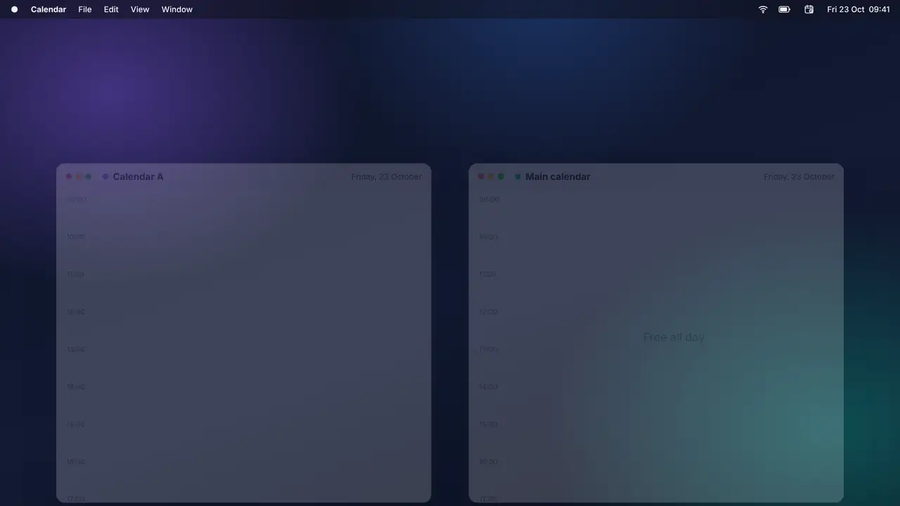
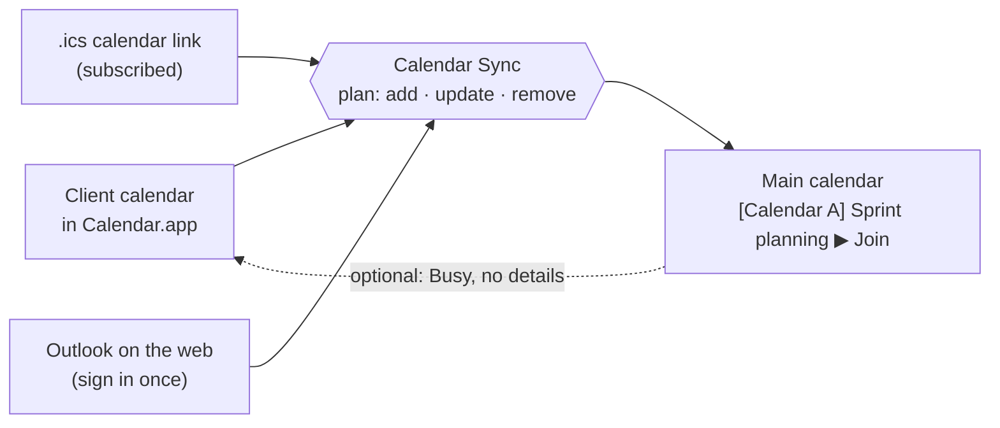

<div align="center">


# Calendar Sync

**Your client meetings, in your main calendar.**

A tiny macOS menu bar app that copies meetings from your client calendars into your main calendar, so colleagues stop booking you over your client standup.

[](https://github.com/neteinstein/Calendar-Sync/actions/workflows/build.yml)


[](LICENSE.md)

<a href="https://github.com/neteinstein/Calendar-Sync/raw/main/docs/calendar-sync.mp4">
  
</a>

<sub>▶ <a href="https://github.com/neteinstein/Calendar-Sync/raw/main/docs/calendar-sync.mp4">Watch with sound</a> · 21 seconds</sub>

</div>

---

## Why

Booked solid at the client. Wide open in your main calendar.

When you work inside a client's calendar, your main calendar (the one your colleagues book you through) says you're free all day. The old fix was a [hand-built Shortcut and a cron job](#coming-from-the-shortcut). Calendar Sync does the same job properly: one install, a settings window, and copies that stay correct when meetings move.

## What you get

<table>
<tr>
<td width="50%" valign="top">

### 🏷️ Named by its calendar
Each copy is titled **`[Calendar name] Meeting name`**, e.g. `[Calendar A] Sprint planning`. For calendars in Calendar.app it uses the calendar's own name and picks up renames.

</td>
<td width="50%" valign="top">

### 🔗 Meeting link included
Teams, Zoom, Google Meet and Webex links are copied onto the event and shown first in its notes, so **Join** works straight from your main calendar.

</td>
</tr>
<tr>
<td valign="top">

### 🔁 Moved? It moves. Cancelled? It's gone.
Copies are matched to their original by a hidden tag, not by title and time. Moved meetings are updated, cancelled ones removed, and recurring meetings just work.

</td>
<td valign="top">

### 🌐 Even browser-only calendars
Client account can't be added to your Mac? Sign in to **Outlook on the web** inside the app once, or subscribe to a published **.ics** link.

</td>
</tr>
<tr>
<td valign="top">

### 🙈 Hide meeting names
Per calendar, copies can be titled `[Calendar A] Busy` instead. The meeting link still comes along.

</td>
<td valign="top">

### 🛡️ Safe by design
It never copies attendees, so no invites go out. It never copies its own copies back, so two-way setups don't loop. If a calendar can't be read, its copies are left alone.

</td>
</tr>
<tr>
<td colspan="2" valign="top">

### ↩️ Show your main calendar as Busy at the client
Optional, per client calendar. Your main calendar's events are added to the client calendar as plain **Busy** events — or **Out of office**, your pick — with the time and nothing else: no title, link, location or attendees. Copies of that client's own meetings are skipped, and meetings copied from other clients do show, so each client sees the time the others have booked. It needs a client calendar you can edit in Calendar.app; Outlook on the web and `.ics` link calendars are read-only.

</td>
</tr>
</table>

It also lets you **skip meetings you declined**, **skip all-day events** and **skip out-of-office events** (on by default). Per client calendar, copies can also get the meeting's **location and description**.

Never miss a start: turn on the optional **full-screen alert** and the screen is covered when a main-calendar meeting begins (or up to 15 minutes before), with buttons to **Join call** (⏎), **Go to** the room, or **Ignore** (⎋). Meetings copied from client calendars alert too, join link included, and each meeting alerts once.

It syncs **every 15 minutes** by default; set any interval from 1 minute to 24 hours, and give a client calendar **its own interval** when it should sync more or less often than the rest (say, Outlook on the web hourly). Calendar.app calendars also sync about 10 seconds after a change. Settings has a **preview** that shows what the next sync would change before it changes anything.

## How it works



Every copy ends its notes with a tag like `calsync:v1:<source id>:<occurrence id>`. The app uses it to recognise its own copies and match them to their originals, which is why a moved meeting gets updated instead of duplicated.

## Client calendars it can read

| Client calendar | How to add it |
|---|---|
| **Added to Calendar.app** (Exchange, Google, iCloud, …) | **Add client calendar › From Calendar.app** |
| **Browser only, with a published link** | **Add client calendar › Calendar link (.ics)**. Calendar.app subscribes to the link, then you pick it like any other calendar. |
| **Browser only: Outlook / Microsoft 365** | **Add client calendar › Outlook on the web**. Sign in once in the app's own window (MFA included). Each sync reloads Outlook's week view in the background, reads the meetings it loads, then loads each meeting in full for its join link and details. *Experimental.* |

<details>
<summary><b>About the Outlook on the web option</b></summary>

<br>

- It reads the same data your browser shows you. Nothing is sent anywhere except into your own calendar.
- It depends on how Outlook's web app works internally, which Microsoft can change without notice. If a sync can't find calendar data, or you've been signed out, the existing copies are **left as they are**. The menu bar icon then shows a warning and an **Open Outlook** button.
- Reading a client's calendar this way may go against the client's IT or security policy. **Check with the client first**, and consider turning on **Hide meeting names** for that calendar.
- Each Outlook calendar keeps its own sign-in, so you can add more than one.

</details>

## Get started

You need **macOS 14 or later** and **Xcode 15+** (the command line tools are enough).

```bash
git clone https://github.com/neteinstein/Calendar-Sync
cd Calendar-Sync
scripts/build-app.sh
open "build/Calendar Sync.app"
```

Allow calendar access on first launch. Then open **Settings…** from the menu bar icon:

1. **General:** choose your **main calendar** (the one meetings are copied into), how many days ahead, and how often to sync. Turn on the **full-screen alert** here if you want one when each meeting starts.
2. **Client calendars:** add each client calendar. For Outlook on the web, also give it a calendar name. Optionally turn on **Copy location and description**, **Use its own sync interval**, or **Show my main calendar here as “Busy”** for any client that should see when you're busy — shown as **Busy** or **Out of office**, whichever you pick.
3. **Preview:** see what a sync would change, then let it run.

> [!NOTE]
> Local builds are ad-hoc signed, so macOS asks for calendar access again after each rebuild.

<details>
<summary><b>Sharing a signed build with colleagues</b></summary>

<br>

To install without Gatekeeper warnings, the app needs a Developer ID certificate (Apple Developer Program, $99/year) and notarization:

```bash
SIGN_IDENTITY="Developer ID Application: Your Name (TEAMID)" UNIVERSAL=1 scripts/build-app.sh
ditto -c -k --keepParent "build/Calendar Sync.app" CalendarSync.zip
xcrun notarytool submit CalendarSync.zip --keychain-profile <profile> --wait
xcrun stapler staple "build/Calendar Sync.app"
```

The bundle identifier is `org.neteinstein.calendarsync`.

</details>

## Development

```bash
swift test
```

The tests cover the sync rules: titles, meeting links, details, moves, deletes, filters, no loops, per-calendar intervals, and the Outlook data parser. They run on Linux too. CI builds the app and runs the tests on macOS for every push.

| Folder | What's in it |
|---|---|
| [`Sources/CalendarSyncCore`](Sources/CalendarSyncCore) | Platform-independent rules: `SyncPlanner` (what to add, update and remove), `SyncSchedule` (which calendars are due), `CopyFormatter` (titles and notes), `MeetingLink`, `CopyMarker`, `HTMLText` and `OutlookWebParser` |
| [`Sources/CalendarSync`](Sources/CalendarSync) | The macOS app: `EventKitBridge` (Calendar.app), `OutlookWebSource` (built-in Outlook browser), `SyncController` (scheduling) and the SwiftUI views |
| [`Tests`](Tests) | Unit tests for the core |
| [`scripts/build-app.sh`](scripts/build-app.sh) | Builds and signs `Calendar Sync.app` |

### Known limits

- Calendar.app refreshes accounts every few minutes, so changes made on the client side show up with that delay.
- If you remove a client calendar from the app, the copies already made from it stay in your calendar. Delete them in Calendar if you no longer want them.

## Coming from the Shortcut?

The original approach was a macOS Shortcut ("Sync Cals") run from cron. Calendar Sync replaces both:

| | Shortcut + cron | Calendar Sync |
|---|---|---|
| Setup | Build the Shortcut by hand, then edit crontab | Install, then pick calendars in Settings |
| Matching copies | Title + start time | Hidden tag per occurrence |
| Moved meeting | Duplicate copy | Copy is moved |
| Cancelled meeting | Separate cleanup Shortcut | Copy is removed |
| Meeting link | Not copied | Copied |
| Browser-only calendars | Not possible | Outlook on the web, `.ics` links |

## License

Calendar Sync is source-available under the [PolyForm Noncommercial License 1.0.0](LICENSE.md). You can use, change and share it for any **noncommercial** purpose, including personal use, research, and use by charities, schools and public bodies. Commercial use needs a separate licence from the author.

Required Notice: Copyright (c) 2026 Pedro Vicente (https://github.com/neteinstein)

<div align="center">
<br>
<sub>Demo video made with <a href="https://github.com/latent-spaces/brag">/brag</a>.</sub>
</div>
